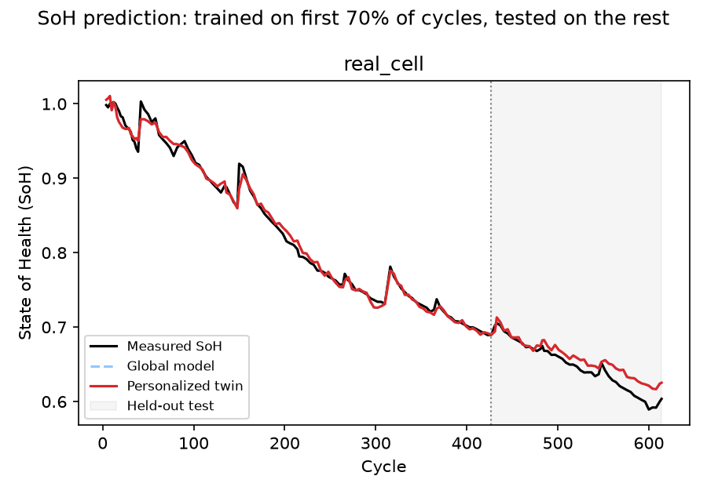
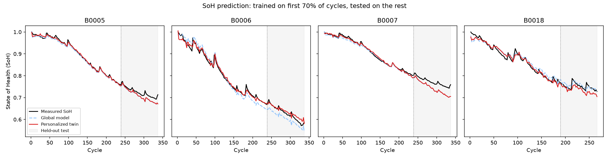

# Multi-Agent Explainable AI Framework for EV Battery Degradation Prediction

A four-agent pipeline (**feature extraction → federated learning + digital
twins → SHAP explainability → edge deployment**) that predicts a battery's
State of Health (SoH) from data a BMS can actually measure.

It runs on real lab cycling data: by default the single cell in
`charging_and_discharging_dataset.csv`, and for the federated part four NASA
PCoE cells (B0005, B0006, B0007, B0018), one FL client each. A synthetic
multi-vehicle fleet is also included to demonstrate the FL mechanics.

This folder is the offline research pipeline behind the project. It is the
validated, reproducible evaluation (real SoH labels, held-out cycles,
baselines, int8 C export). The interactive dashboard lives in `../backend`
and `../frontend`. Run every command below from inside `research/`.

## Data

The datasets are not in Git (they are too large); get them separately:

- **Single cell:** place `charging_and_discharging_dataset.csv` (about 83 MB,
  shared by the team) in `research/`. It is NASA PCoE cell B0006 with some
  samples missing (limitation 5).
- **Four NASA cells:** download the NASA "Battery Data Set" and convert it
  with `data/nasa_to_csv.py` (see *Four real cells* below). This writes
  `data/nasa/`.
- **No data at hand:** `orchestrator.py --data synthetic` runs on a generated fleet.

## Key findings

- **SoH can be predicted from partial, BMS-measurable signals** to about
  **1–2 percentage points** on cycles the model has never seen (single cell:
  MAE 0.012; four NASA cells: 0.017, or 0.019 averaged over 5 seeds). That's 2–3× better than assuming SoH
  falls linearly with throughput.
- **A plain linear (ridge) model is as good or better** on this data: 0.008 on
  the single cell, 0.015 per cell on the four NASA cells. The MLP + federated +
  digital-twin stack is justified by **privacy** (no raw data leaves a
  vehicle) and by the deployment story, not by accuracy on these datasets.
- **The strongest health signal** is the voltage sag in the first 300 s of a
  discharge (internal-resistance growth), followed by charge-phase timing.
- **It really runs on a microcontroller-class target:** the twin compiles to
  ~0.75 KB of C (code + int8 weights). Its outputs match the Python model to
  within 4e-7 on every cycle of all 9 exported twins.

## How to run

```bash
cd research
python -m venv .venv
.venv/Scripts/pip install -r requirements.txt    # Linux/macOS: .venv/bin/pip
.venv/Scripts/python orchestrator.py              # real data
.venv/Scripts/python orchestrator.py --data synthetic --out outputs/synthetic
.venv/Scripts/python orchestrator.py --csv cellA.csv cellB.csv cellC.csv  # one CSV per cell = one FL client
```

Options: `--train-frac` (default 0.7), `--rounds` (200), `--lr` (0.1),
`--seed` (0, MLP initialisation), `--no-loco`, `--out`.

```bash
.venv/Scripts/python -m unittest discover -s tests -v   # 10 tests, ~3 s
.venv/Scripts/python edge/verify_edge.py outputs/edge_model_real_cell.json outputs/features.csv
```

### Four real cells (NASA PCoE)

```bash
# 1. download the NASA "Battery Data Set" (~210 MB zip, all 34 NASA cells):
#    https://phm-datasets.s3.amazonaws.com/NASA/5.+Battery+Data+Set.zip
# 2. convert B0005/6/7/18 to this repo's CSV schema (impedance cycles dropped):
.venv/Scripts/python data/nasa_to_csv.py --zip "5. Battery Data Set.zip" --out data/nasa
# 3. federated run + leave-one-cell-out evaluation
.venv/Scripts/python orchestrator.py --csv data/nasa/B0005.csv data/nasa/B0006.csv data/nasa/B0007.csv data/nasa/B0018.csv --out outputs/nasa
```

`data/nasa/` is git-ignored (~300 MB of CSV); the converter rebuilds it in
about 20 s. Source: B. Saha and K. Goebel (2007), "Battery Data Set", NASA
Ames Prognostics Data Repository.

## Results on the single real cell

This cell turned out to be NASA **B0006** with some samples missing (see
limitation 5), so don't pass it together with `data/nasa/B0006.csv`.

Single 24 °C cell, 165 usable discharge cycles, capacity 1.99 Ah → 1.20 Ah
(SoH 1.00 → 0.60). Models are trained on the **first 70 % of cycles** and
scored on the **last 50 cycles they never saw**, i.e. predicting further
degradation, not interpolating.

| Model (held-out later cycles) | MAE (SoH) | RMSE | R² |
|---|---|---|---|
| MLP digital twin (this pipeline) | 0.0120 | 0.0146 | 0.80 |
| Ridge regression, same features | **0.0080** | **0.0105** | **0.89** |
| Linear trend on Ah throughput only | 0.0275 | 0.0282 | 0.24 |

An MAE of 0.012 means about **1.2 percentage points of SoH**. Both
feature-based models clearly beat the "battery ages linearly with use"
baseline. On a single cell, the plain linear model still beats the MLP: 115
training cycles is too little for the neural network to pay off. Report that
honestly. The four-cell results below test whether more clients change that.



Top SHAP drivers of predicted SoH: early-discharge voltage sag
(internal-resistance growth), throughput / equivalent full cycles, mean
early-discharge voltage, and constant-current charge duration. The surrogate
used for SHAP reproduces the twin's predictions with R² ≈ 1.00, so the
explanations describe the deployed model faithfully.

Edge: 186 parameters, 744 B in float32 → 186 B in int8, ~0.01 ms per
prediction in Python, with no accuracy loss from quantization (test MAE
0.0120 → 0.0103). The int8 model and its input scaler are exported to
`outputs/edge_model_<cell>.json`.

## Results on four real cells (federated, NASA PCoE)

B0005, B0006, B0007, B0018: 18650 cells at 24 °C, 1.5 A CC/CV charge, 2 A
discharge to 2.7 / 2.5 / 2.2 / 2.5 V. 628 usable discharge cycles
(166 / 166 / 166 / 130). SoH at end of test: 0.69 / 0.57 / 0.74 / 0.73.
Full numbers: `outputs/nasa/pipeline_report.json`.

**The MLP is sensitive to its random initialisation.** Ridge and the trend
line are deterministic; the MLP is not. So every MLP number below gives seed 0
(the committed run) plus the mean and range over seeds 0–4 (`--seed`). A gap
smaller than that range is not a result.

### A. Chronological split (first 70 % of each cell trains, last 30 % is tested)

Federated training on 4 clients, then each client fine-tunes its own twin.
190 held-out cycles in total.

| Model (held-out later cycles, 4 cells pooled) | MAE, seed 0 | MAE, 5 seeds: mean (range) | R², seed 0 |
|---|---|---|---|
| MLP digital twin (FedAvg + fine-tune) | 0.0172 | 0.0187 (0.0106–0.0249) | 0.88 |
| Ridge, one per cell (centralised per cell) | **0.0153** | 0.0153 | **0.89** |
| Ridge, all cells pooled (centralised) | 0.0204 | 0.0204 | 0.84 |
| Linear trend on Ah throughput | 0.0530 | 0.0530 | −0.04 |

Global FedAvg model vs. personalized twin per cell (held-out MAE, mean over 5 seeds):

| Cell | Global | Twin | Twin better in |
|---|---|---|---|
| B0005 | 0.0205 | 0.0187 | 5 / 5 seeds |
| B0006 | 0.0215 | 0.0119 | 3 / 5 |
| B0007 | 0.0293 | 0.0273 | 4 / 5 |
| B0018 | 0.0142 | 0.0166 | 1 / 5 |



### B. Leave-one-cell-out (train on 3 cells, test on every cycle of the 4th)

This is the question a fleet actually faces: how well does the shared model
do on a battery it has never seen? FedAvg runs on the 3 training cells; ridge
and the trend are fitted centrally on the same 3 cells. There is no twin
here, since the new cell has nothing to fine-tune on.

| Unseen cell | FedAvg MLP, seed 0 | FedAvg MLP, 5 seeds: mean (range) | Ridge | Trend |
|---|---|---|---|---|
| B0005 | 0.0091 | 0.0106 (0.0089–0.0140) | **0.0090** | 0.0326 |
| B0006 | 0.0328 | 0.0365 (0.0254–0.0595) | **0.0143** | 0.0828 |
| B0007 | **0.0065** | 0.0085 (0.0056–0.0120) | 0.0184 | 0.0753 |
| B0018 | 0.0367 | 0.0353 (0.0268–0.0495) | **0.0244** | 0.0301 |
| **Pooled (628 cycles)** | 0.0204 | 0.0220 (0.0168–0.0298) | **0.0161** | 0.0567 |

### What this says

- **Ridge still wins.** With four cells, a per-cell ridge beats the MLP
  twin's average on the chronological split (0.0153 vs 0.0187), and pooled
  ridge beats the FedAvg MLP on unseen cells (0.0161 vs 0.0220). The best MLP
  seed beats ridge in both settings, but picking the seed after seeing the
  test score would be cheating. With ~120 training cycles per cell and
  features that are close to linear in SoH (on B0005–B0007 every feature has
  |r| ≥ 0.8 with SoH), a linear model is hard to beat.
- **Personalization helps on average, not always.** The twin beats the
  shared global model on B0005, B0006 and B0007 in most seeds and loses on
  B0018, the cell with the fewest cycles and the most rest-induced capacity
  jumps.
- **A new cell is the hard case.** B0006 (fastest fade, ends at SoH 0.57,
  below anything the other cells reach) and B0018 (capacity recovery after
  rests) are where every model does worst. On unseen B0018 even the
  throughput trend beats the MLP.
- **What FL buys here is privacy, not accuracy.** Ridge is centralised: it
  sees every cell's raw data. FedAvg gets errors of the same order without
  moving raw data, but on this data it doesn't beat the centralised linear
  model.
- Both feature models beat the throughput-only trend everywhere except
  unseen B0018, so the charge-window and early-discharge features carry
  information beyond usage.

SHAP (4 cells): early-discharge voltage sag dominates (mean |SHAP| 0.082,
10× the next feature), then CV duration, CC duration and charge-window Ah.
Surrogate fidelity R² = 0.997. Int8 export: 186 B per twin, with test MAE
changing by less than 0.003.

## Results on the synthetic fleet (FL demo only)

Five simulated vehicles with different heat and fast-charge habits (non-IID).
Held-out MAE: personalized twins **0.0072** vs. one shared ridge 0.037. Per
vehicle, the twin cuts the shared global model's error by 2–9×, so
personalization matters when clients differ. But a separate ridge per vehicle
does better still (**0.0017**): the simulator makes each vehicle's SoH almost
linear in its throughput, which a per-vehicle linear fit captures exactly.
Read this section as a working demo of the FL and twin mechanics on data
whose degradation law is written in `data/generate_data.py`. It is not
evidence about real batteries.

## Edge deployment (`edge/`)

Each twin is exported as `outputs/edge_model_<cell>.json`: int8 weights, one
scale and offset per layer, and the input scaler. From that file:

| File | What it is |
|---|---|
| `edge/build_c_model.py` | JSON → `soh_model.h` (weights stay int8 in flash) |
| `edge/soh_infer.c` | `float soh_predict(const float raw[9])`: C99, no heap, only `<math.h>` |
| `edge/soh_model.h` | generated header for the single real cell, as an example |
| `edge/soh_infer.py` | the same inference with no third-party imports (MicroPython-ready) |
| `edge/verify_edge.py` | runs both on every cycle of a cell and compares them to the NumPy model |

```bash
.venv/Scripts/python edge/build_c_model.py outputs/edge_model_real_cell.json edge/soh_model.h
gcc -Os -std=c99 -c -I edge edge/soh_infer.c        # 752 B object (x86, code + weights)
```

Verified on all 9 exported twins (1 real cell, 4 NASA, 5 synthetic):
max |C − Python| ≤ 4e-7 (float32 rounding), max |pure-Python − NumPy|
≤ 6e-16. The int8 model is 186 B of weights. Measured on x86 with MinGW
gcc 6.3; it has not been run on actual MCU hardware.

## How labels and features are built (`agents/data_loader.py`)

- **Label:** capacity = charge delivered over a full discharge (final
  `cummulative Ah` of the discharge cycle). SoH = capacity ÷ capacity of the
  first discharge.
- **Features:** chosen so the model can't just read the label back from a
  full discharge:
  - *Preceding charge:* constant-current duration, constant-voltage duration,
    time and Ah spent between 3.9 V and 4.1 V (a partial window a car passes
    through on most top-ups), starting voltage.
  - *First 300 s of the discharge only:* voltage sag and mean voltage.
  - *History:* cumulative Ah and equivalent full cycles **before** this cycle.
- Cycles are dropped when the charge log is truncated or starts above 3.9 V
  (window features would be wrong). That leaves 165 of 168.

## Architecture

| Agent | File | Role |
|---|---|---|
| Data / feature extraction | `agents/data_loader.py` (real), `agents/feature_agent.py` (synthetic) | One labelled feature row per cycle per client |
| Federated aggregator + digital twin | `agents/fl_digital_twin_agent.py`, `agents/mlp.py` | Each client trains locally; FedAvg builds a global model; each client fine-tunes a personal twin. Only `split == "train"` rows are ever fitted (including the scaler). |
| Explainability | `agents/xai_agent.py` | RandomForest surrogate of the twin + SHAP TreeExplainer; reports surrogate fidelity; per-cycle explanations with feature values and direction |
| Edge deployment | `agents/edge_agent.py`, `edge/` | Latency benchmark, int8 quantization (vs. a float32 baseline), JSON export, generated C and MicroPython inference |

The model is a NumPy MLP with a linear skip path,
`y = x·Ws + tanh(x·W1 + b1)·W2 + b2`, plus small weight decay. The skip path
was added because a pure tanh network flattens out and can't follow SoH below
the training range: test MAE went from 0.025 to 0.012.

## Limitations (say these before a reviewer does)

1. **Four clients is still a small federation.** All four NASA cells share
   chemistry, temperature and charge protocol and were cycled in the same lab;
   they differ mainly in discharge cut-off voltage. That is far less
   heterogeneous than a real fleet. Leave-one-cell-out has only 4 folds, so
   per-cell numbers are noisy. (The default single-cell run is one client, so
   FedAvg there is ordinary training; it prints a warning.)
2. **MLP results depend on the seed** (pooled MAE 0.011–0.025 across seeds on
   the chronological split). Compare means over seeds, not single runs. The
   single-cell numbers above are seed 0 only.
3. Constant 24 °C ambient, and the CSV schema drops NASA's cell-temperature
   column, so temperature effects can't be learned from the real data.
4. Lab cycling (full charge, constant 2 A discharge) is cleaner than real
   driving. The partial-window features are the part meant to transfer.
5. **`charging_and_discharging_dataset.csv` is NASA B0006 with gaps.** The
   first sample of every cycle and the last ~6 samples of every discharge
   (≈3.0 V down to the 2.5 V cut-off) are missing, so its capacities, and
   hence its SoH labels, are about 3 % low (first discharge 1.99 Ah vs
   2.05 Ah from the NASA file). The single-cell numbers above use it as is;
   `data/nasa/B0006.csv` is the complete version.
6. Capacity is integrated from the logged current, so it runs 0.3–1.5 %
   above NASA's own `Capacity` field. SoH is a ratio, so this mostly cancels.
7. Hyperparameters (rounds, learning rate, network size) were set on the
   single cell from training-loss convergence and not retuned for four cells.
   Test cycles were never used for tuning.

## Outputs

`outputs/` (single real cell), `outputs/nasa/` (four NASA cells) and `outputs/synthetic/`:
`pipeline_report.json` (all numbers), `twin_predictions.png`,
`shap_importance.png`, `fl_training_curve.png`, `sample_explanations.txt`,
`edge_model_*.json`, and `features.csv` (the labelled per-cycle feature
table that run used).

Tests: `tests/test_pipeline.py` covers FedAvg weighting, the skip path's
extrapolation, label/feature extraction on a generated cell, the dropped-
charge rule, the chronological split, that test rows never reach the scaler,
quantization error bounds, C/Python/NumPy agreement, and an end-to-end run.
